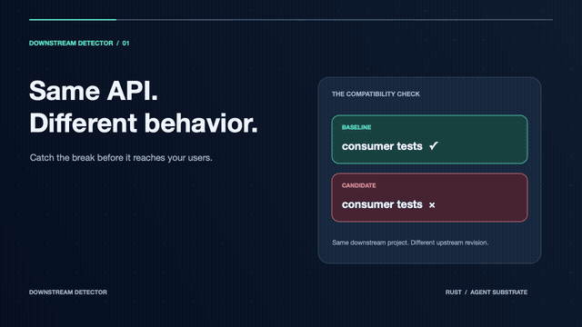

# Downstream Detector

Checks whether a proposed Rust dependency change breaks the software that depends on it.

## Why I built it

I work on platform problems where one shared library serves many product teams. A change can keep compiling while subtly breaking a consumer. I wanted a way to submit a pull request and learn which downstream projects fail before the change ships.

## How to use it

After one-time setup of the Agent Substrate worker image, credentials, and (for a private company) organization settings, the check takes a pull request URL:

```sh
downstream-detector check https://github.com/OWNER/REPO/pull/123
```

It identifies the changed Rust crate, discovers and ranks consumers, runs their tests in parallel isolated actors, and prints a short result summary. Full test output and backtraces are saved under `.downstream-detector/reports/`. Public consumer discovery uses crates.io; set `DETECTOR_GITHUB_ORG` and a GitHub token to include company repositories found through code search. For GitHub Enterprise Server, also set `DETECTOR_GITHUB_HOST`. The demo does not yet automatically configure a company's credentials or internal Cargo registry.

The local `itoa` → `serde_json` compatibility example is available with `bash demo/itoa-serde/run.sh`.

## How Agent Substrate fits

Each downstream test is an isolated actor scheduled on a worker pool, with CPU and memory limits, network policy, and retained logs. That lets the tool fan out to consumers without maintaining a worker per repository. Agent Substrate documents warm actor resume under 500 ms and over 500 activations per second; those are platform figures, not this demo's benchmark ([architecture](https://ate.dev/docs/concepts/architecture/)).

In the recorded local Kind/gVisor run, an actor had **1 vCPU and 1 GiB RAM**. Cargo reported **49.18 s** to build the baseline, **48.78 s** for its doc tests, and **42.64 s** to build the candidate; the failing candidate test target finished in **0.12 s**. These are individual phases, not end-to-end latency, and vary with hardware and cache state. See the [full run report](demo/itoa-serde/report.txt).

## Video demo

[](demo/itoa-serde/walkthrough.mp4)

[Play or download the 36-second video](demo/itoa-serde/walkthrough.mp4).
